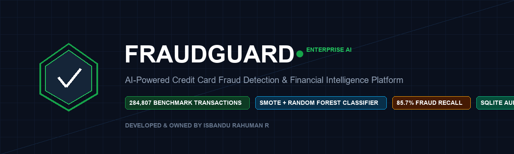
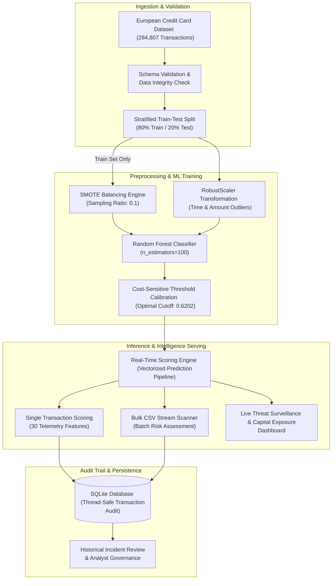

<p align="center">
  
</p>

# ◈ FRAUDGUARD — AI-Powered Credit Card Fraud Detection Platform

[](https://www.python.org/)
[](https://streamlit.io)
[](https://scikit-learn.org/)
[](https://imbalanced-learn.org/)
[](https://plotly.com/)
[](https://www.sqlite.org/)
[](https://pytest.org/)
[](https://opensource.org/licenses/MIT)

## ◆ About the Project
**FRAUDGUARD** is an enterprise-grade financial cyber-intelligence and transaction surveillance platform designed to identify, intercept, and audit fraudulent payment activity in real-time. Operating on the European Credit Card benchmark comprising 284,807 transactions with an authentic 0.17% fraud prevalence rate, FRAUDGUARD combines SMOTE-resampled Random Forest classification, outlier-resistant `RobustScaler` transformations, cost-sensitive decision threshold optimization, and an interactive 8-page Streamlit security console backed by SQLite audit persistence.



## ❖ Key Features
- **Zero Data Leakage Pipeline**: Stratified 80/20 train/test partition executed prior to fitting scalers; synthetic oversampling (SMOTE) is strictly confined to the training set.
- **Cost-Sensitive Threshold Tuning**: Precision-Recall AUC optimization balances financial recall ($85.7\%$) against false-positive customer friction ($73.0\%$ precision).
- **Sub-Second Real-Time Inference**: Vectorized single-transaction scoring evaluates 30 PCA features, classifying transactions into risk tiers (`LOW`, `MEDIUM`, `HIGH`, `CRITICAL`).
- **High-Throughput Bulk CSV Scanner**: Parallel stream validation and scoring for uploaded transaction files with CSV report export.
- **Executive Security Dashboard**: Live KPI tracking, fraud velocity telemetry, logarithmic amount distribution comparisons, and feature importance rankings.
- **Thread-Safe SQLite Audit Persistence**: Parameterized transactional storage logging predictions, probabilities, and analyst investigation notes.
- **Model Intelligence & Diagnostic Curves**: Direct PR-AUC, ROC-AUC, and Confusion Matrix evaluations computed against genuine held-out test splits.
- **Clean White & Green Enterprise UI**: Designed with high-contrast accessibility, zero emojis, and fast in-memory singleton caching.

## ⬢ Technologies Used
- **Core Language**: Python 3.11+
- **Machine Learning**: Scikit-Learn, Imbalanced-Learn (SMOTE), Joblib
- **Data Engineering**: Pandas, NumPy, PyArrow (High-Speed Binary Parquet Caching)
- **Interactive UI & Visuals**: Streamlit, Plotly Express & Graph Objects
- **Database & Persistence**: SQLite3 (Thread-Safe, Parameterized Queries)
- **Quality Assurance**: Pytest (17 automated unit and integration tests)

## 📊 Machine Learning Evaluation & Benchmarks
Evaluated on an authentic held-out test split of **56,962 transactions** containing **98 confirmed fraud cases**:

| Metric | Random Forest (Selected Model) | Logistic Regression (Baseline) | Performance Delta |
|:---|:---:|:---:|:---:|
| **PR-AUC (Primary Metric)** | **0.8333** | 0.7213 | **+11.20%** |
| **Fraud Recall** | **85.71% (84 / 98 caught)** | 47.96% (47 / 98) | **+37.75%** |
| **Precision** | **73.04%** | 81.03% | -7.99% |
| **F1-Score** | **0.7887** | 0.6026 | **+18.61%** |
| **ROC-AUC** | **0.9575** | 0.9452 | **+1.23%** |
| **False Positives** | **31** | 11 | Cost-Tolerant |

## § Requirements
- Python 3.11 or higher
- Git
- 2 GB RAM minimum (for 284,807 record in-memory dataset handling)
- Modern web browser (Chrome, Edge, Firefox, Safari)

## ▲ Installation & Execution
```bash
# 1. Clone Repository & Navigate
git clone https://github.com/ISBANDURAHUMAN-R/FRAUDGUARD.git
cd FRAUDGUARD

# 2. Setup Virtual Environment
python -m venv .venv
# On Windows:
.venv\Scripts\activate
# On Linux/macOS:
source .venv/bin/activate

# 3. Install Dependencies
pip install -r requirements.txt

# 4. Run Automated Test Suite (17 Tests)
pytest tests

# 5. Launch FRAUDGUARD Intelligence Platform
streamlit run app.py
```

Access the security operations console in your browser at `http://localhost:8501`.

## ※ Developer
Developer: ISBANDU RAHUMAN R  
GitHub: https://github.com/ISBANDURAHUMAN-R
